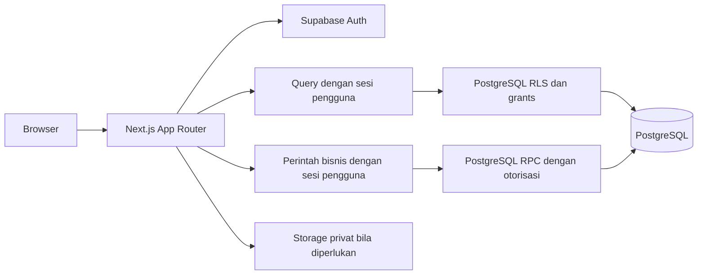

# Arsitektur yang direkomendasikan

Gunakan monolit modular Next.js dengan satu database PostgreSQL di Supabase. PR, reservasi, receipt, update saldo, history dan event membutuhkan commit bersama. Pemisahan layanan pada tahap awal akan membuat transaksi ini lebih sulit direkonsiliasi.



- Server Components merender data dengan data-access layer request-scoped. Client Components menangani input interaktif. Server Actions menangani mutasi browser dan Route Handlers menangani ekspor serta callback auth. Setiap pintu masuk memeriksa sesi, scope dan input.
- Query biasa memakai RLS dengan kredensial pengguna. RPC transaksi memeriksa role dan scope terkini serta menulis status, saldo, ledger dan event sebagai satu commit. Kesalahan dipetakan ke validation, forbidden, not found, conflict, dan internal error dengan correlation ID.
- Data privat dikueri per permintaan. Urutan tabel deterministik dengan primary key sebagai tie-breaker. Search/filter berada di URL. Ekspor memakai query berizin yang sama dan batas volume yang ditentukan dari uji beban.
- Gunakan notifikasi in-app dari tabel yang diisi pada commit. Print CSS dan halaman dokumen berizin melayani cetak/PDF browser. Ekspor CSV dialirkan bila sesuai. Integrasi email PO, Realtime dan Edge Functions menunggu kebutuhan operasional yang membenarkan kegunaannya.
- Riwayat memakai perubahan status dan log audit terpisah. Gunakan correlation ID untuk mengaitkan request, transaksi, dan log. Simpan snapshot nama, SKU, UOM, vendor dan harga pada dokumen yang perlu dicetak ulang.

## Struktur yang direncanakan

```text
src/
  app/
    (auth)/                  login, recovery, callback
    (workspace)/             dashboard dan route modul terproteksi
    api/                     ekspor dan integrasi bila diperlukan
    layout.tsx
    globals.css
  components/                layout, UI, tables, forms
  features/
    auth/ users/ dashboard/ master-data/
    purchasing/ procurement/ inventory/
    reports/ notifications/ audit/
  lib/                       env, Supabase, auth guard, error mapping
  types/                     tipe database hasil generate
supabase/
  migrations/
  seed.sql
  tests/
tests/
  unit/
  e2e/
docs/
```

Dalam modul, pisahkan schema input, query, command adapter dan komponen. Pilih versi stabil yang kompatibel saat Phase 1, pin runtime dan package manager, lalu simpan lockfile. Referensi resmi untuk boundary server dan RLS. [Next.js authentication](https://nextjs.org/docs/app/guides/authentication) · [Supabase RLS](https://supabase.com/docs/guides/database/postgres/row-level-security).
