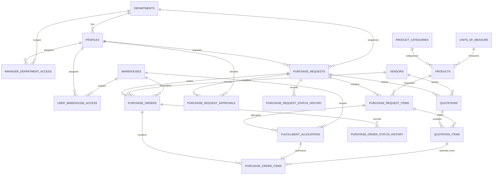
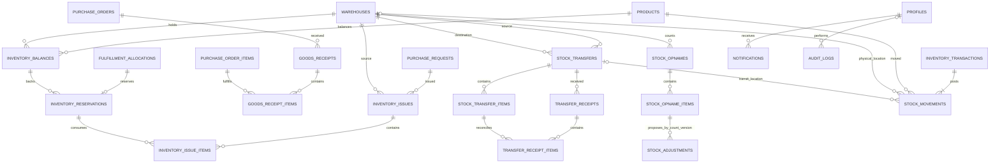

# ERD logis

Diagram dibagi menurut domain. Entitas yang muncul pada dua diagram merujuk ke tabel yang sama. Lihat [rancangan skema](schema.md) untuk kunci unik, relasi histori, dan kontrol konkurensi.

## Organisasi hingga PO

## Persediaan dan jejak transaksi

Profil berelasi 1:1 ke Supabase Auth. Baris ledger memakai lokasi fisik atau akun transit per baris transfer. FK sumber transaksi dijelaskan di rancangan skema. Notifikasi dan audit menyimpan referensi entitas serta metadata event. Akses ke dokumen tujuan diperiksa saat dibuka.
